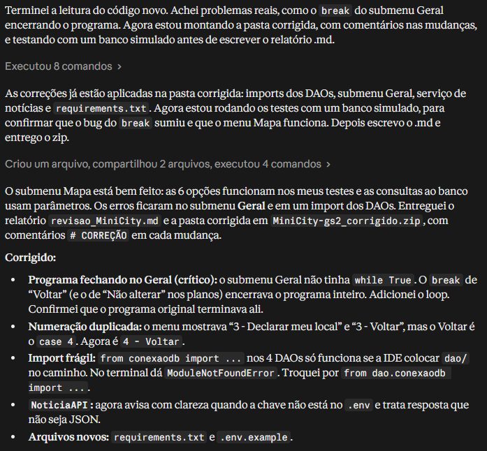

# MiniCity - Global Solution 2

## Alunos
- Breno Elisio Leal Lobato – RM 569961
- Chrisitian Verzellesi Barbuto – RM 568677
- Eduardo Nery Kurahara – RM 570916
- Eduardo Pizzoli Junior – RM 569529
- Gustavo Lizier Pontes – RM 573234

- Todos são da turma 1TDSPJ

Este projeto foi desenvolvido para a entrega da Global Solution da matéria de Computational Thinking Using Python. Nele, foram utilizadas tecnologias como hashlib, oracledb, requests e python-dotenv.
O projeto realiza uma busca em uma API de notícias, além de se comunicar com um banco de dados Oracle.

## Relatório do Uso de IA

- Ferramenta utilizada: Claude

Neste projeto, a inteligência artificial foi usada para fins de correção e prevenção de erros, ajudando a evitar bugs no projeto.
Abaixo, segue uma imagem do uso da IA:

